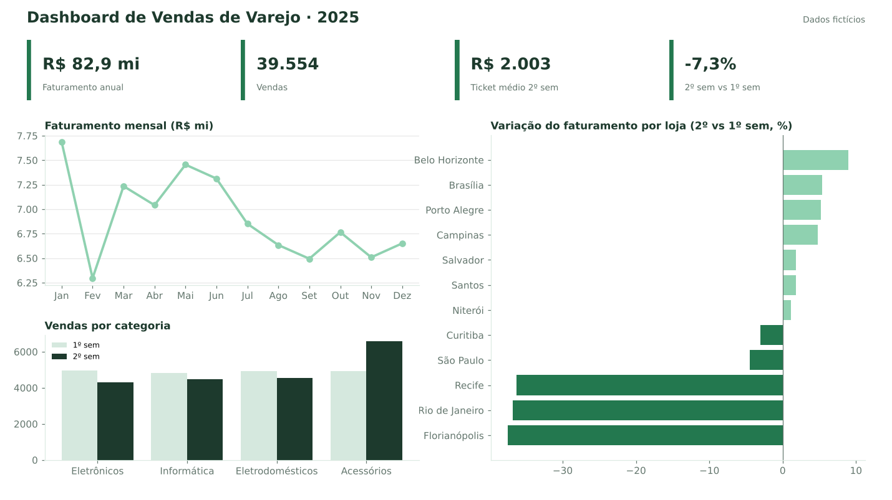

# Portfólio — Gustavo Valle de Moraes

Portfólio de Dados & BI com projetos usando dados fictícios.

## Projetos
- [Vendas de Varejo](projetos/vendas-varejo) — Power BI + DAX
- [Churn de Assinaturas](projetos/churn-assinaturas) — SQL (PostgreSQL)
- [People Analytics: Turnover](projetos/people-analytics-turnover) — Power BI + Power Query

Site em HTML, CSS e JavaScript, publicado no GitHub Pages: https://gumoraez.github.io/Portif-lio/

## Como funciona
- Site estático em `frontend/`, publicado automaticamente no GitHub Pages a cada alteração.
- Formulário de contato enviado por e-mail via FormSubmit.
